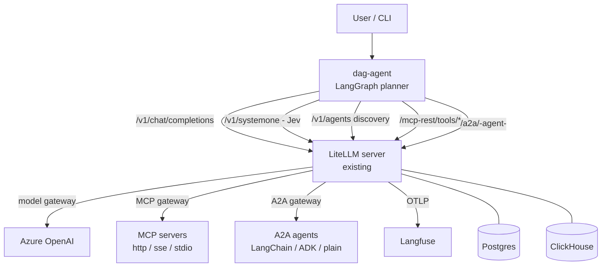

# LiteLLM Gateway Stack — Deployment Guide

Deploys MCP tool servers and A2A agents, registers them with an **existing**
LiteLLM server, and runs a LangGraph planner that discovers and invokes both at
runtime.

This assumes LiteLLM is **already installed and running elsewhere** with its own
Postgres/Prisma and ClickHouse. Nothing here installs or migrates LiteLLM. What
you deploy is everything *around* it, plus the registration calls that make the
gateways aware of it.

---

## 1. Architecture



The planner never talks to an MCP server or an agent directly. Every call goes
through LiteLLM, which is what gives you one key, one audit trail, one spend
ledger and one set of permissions.

**The single most important networking fact:** LiteLLM dials *out* to your MCP
servers and agents. Any `127.0.0.1` URL you register will be interpreted on the
LiteLLM host, not yours. Every URL below must be routable **from the LiteLLM
server**.

---

## 2. Prerequisites

Collect these from whoever runs the LiteLLM server before you start.

| Item | Why | Example |
|---|---|---|
| `LITELLM_PROXY_URL` | every call target | `https://litellm.internal.example.com` |
| Virtual key or master key | auth | `sk-...` |
| LiteLLM version | gates features | must be **>= 1.104.2** |
| Write access to `config.yaml` **or** admin key | registration | either path works |
| `STORE_MODEL_IN_DB=True` on the server | REST registration persistence | required for the API path |
| Langfuse host + keys | tracing | `http://10.166.133.180:3000` |
| Network path | gateway dials out | LiteLLM host → your host, on the MCP/A2A ports |

Version check — if this is below `1.104.2`, `/v1/decisions` and `/v1/systemone`
do not exist and the planner's Jev step will 404:

```bash
curl -s $LITELLM_PROXY_URL/health/readiness -H "Authorization: Bearer $LITELLM_KEY"
pip show litellm | grep -i version    # on the LiteLLM host
```

---

## 3. Repository layout

Create one repo. Four deployables plus shared ops files.

```
litellm-gateway-stack/
├── README.md
├── .gitignore
├── .env.example                    # committed; real .env is not
│
├── mcp-servers/                    # deployable 1
│   ├── pyproject.toml
│   ├── app_fastapi.py              # plain REST API, :8000
│   ├── mcp_http.py                 # FastMCP streamable HTTP, :8001
│   ├── mcp_openapi.py              # MCP generated from app_fastapi's OpenAPI, :8002
│   ├── mcp_sse.py                  # FastMCP SSE, :8003
│   └── mcp_stdio.py                # stdio; runs ON the LiteLLM host
│
├── a2a-agents/                     # deployable 2
│   ├── requirements.txt
│   ├── config.py                   # HOST/PORT constants — must be edited
│   ├── a2a_min.py                  # agent card + message/send in ~40 lines
│   ├── registry.py                 # :7000
│   ├── agent_weather_langchain.py  # :7001
│   ├── agent_currency_adk.py       # :7002
│   ├── agent_time_plain.py         # :7004
│   ├── supervisor.py               # :7003 (optional, not an A2A agent)
│   └── run_all.py                  # dev convenience only
│
├── dag-agent/                      # deployable 3
│   ├── pyproject.toml
│   ├── run_dag_agent.py
│   └── dag_agent/
│       ├── __init__.py
│       ├── gateway.py              # discovery + invocation
│       ├── nodes.py                # begin / intent / decompose / plan / map / orchestrate / synthesize / finish
│       ├── graph.py                # wiring, Jev conditional edge, per-node tracing
│       ├── observability.py        # Langfuse + /v1/workflows + /v1/memory
│       └── a2a_server.py           # :7005 — fronts the graph so it can be registered
│
├── litellm-config/                 # deployable 4 — applied on the LiteLLM host
│   ├── config.yaml                 # model_list + mcp_servers + agents + litellm_settings
│   └── register.py                 # REST alternative to editing config.yaml
│
└── deploy/
    ├── systemd/*.service
    ├── serve_proxy.py              # only if you also run a proxy yourself
    └── proxy_service.py            # Windows service wrapper
```

### What must never be committed

```gitignore
.env
*.env
!.env.example
.venv/
certs/
__pycache__/
*.py[oc]
```

Secrets in scope: `LITELLM_MASTER_KEY`, `AZURE_*_API_KEY`, `LANGFUSE_SECRET_KEY`,
`TYPESAFE_API_KEY`, `DATABASE_URL`. Note that `config.yaml` **is** committed, so
it must only ever reference secrets as `os.environ/NAME` — never inline.

---

## 4. Step 1 — Deploy the MCP servers

**Host:** anywhere the LiteLLM server can reach. **Ports:** 8000–8003.

```bash
cd mcp-servers
python -m venv .venv && . .venv/bin/activate
pip install fastmcp fastapi uvicorn httpx
```

### Bind to a routable interface

The demo files bind `127.0.0.1`. For a server deployment change each `mcp.run()`
host to `0.0.0.0` (and firewall the ports to the LiteLLM host only):

```python
mcp.run(transport="http", host="0.0.0.0", port=8001, stateless_http=True)
```

### Start order matters

`mcp_openapi.py` reads `http://<api-host>:8000/openapi.json` **at import time**.
If the REST API is not already up, it crashes on boot. Start 8000 first.

```bash
python app_fastapi.py     # :8000  must be first
python mcp_http.py        # :8001
python mcp_sse.py         # :8003
python mcp_openapi.py     # :8002  depends on :8000
```

### systemd

`deploy/systemd/mcp-http.service` — repeat per server:

```ini
[Unit]
Description=FastMCP Calculator (streamable HTTP)
After=network-online.target
Wants=network-online.target

[Service]
Type=simple
User=svc-mcp
WorkingDirectory=/opt/litellm-gateway-stack/mcp-servers
ExecStart=/opt/litellm-gateway-stack/mcp-servers/.venv/bin/python mcp_http.py
Restart=always
RestartSec=5

[Install]
WantedBy=multi-user.target
```

For `mcp-openapi.service` add the dependency so boot order is correct:

```ini
After=network-online.target mcp-api.service
Requires=mcp-api.service
```

```bash
sudo systemctl daemon-reload
sudo systemctl enable --now mcp-api mcp-http mcp-sse mcp-openapi
```

### Verify locally before registering

```bash
curl -s http://localhost:8000/add?a=2&b=3        # {"result":5}
curl -isS http://localhost:8001/mcp | head -1    # expect 400/406, not refused
```

---

## 5. Step 2 — Register the MCP servers in the MCP gateway

Two paths. Use **A** if you control the LiteLLM `config.yaml`, **B** otherwise.

### Path A — config.yaml on the LiteLLM host

```yaml
mcp_servers:
  calc_http:
    url: "http://mcp-host.internal:8001/mcp"
    transport: "http"
    description: "FastMCP Calculator over streamable HTTP"
  calc_sse:
    url: "http://mcp-host.internal:8003/mcp"
    transport: "sse"
    description: "FastMCP Calculator over SSE"
  calc_openapi:
    url: "http://mcp-host.internal:8002/mcp"
    transport: "http"
    description: "Tools generated from the FastAPI OpenAPI spec"
```

Restart the LiteLLM server. Config-defined servers are **not** stored in the
database and cannot be edited from the Admin UI — change the file and restart.

### Path B — REST, no config file access

Requires `STORE_MODEL_IN_DB=True` on the server. Verified payload:

```bash
curl -X POST $LITELLM_PROXY_URL/v1/mcp/server \
  -H "Authorization: Bearer $LITELLM_KEY" \
  -H "Content-Type: application/json" \
  -d '{
    "server_name": "calc_http",
    "alias": "calc_http",
    "description": "FastMCP Calculator over streamable HTTP",
    "transport": "http",
    "url": "http://mcp-host.internal:8001/mcp"
  }'
# -> 201 {"server_id":"...","is_config":false,...}
```

Delete with `DELETE /v1/mcp/server/{server_id}` (returns 202).

### Naming constraint

Server names must comply with **SEP-986**. LiteLLM prefixes every tool with its
server name (`calc_http-add`), so non-compliant names are rejected on create and
legacy ones only warn today. Stick to lowercase, digits and underscores.

### The stdio server is a special case

A stdio MCP server is **launched by the LiteLLM process itself**. It does not
listen on a port and it does not run on your host. Therefore:

1. `mcp_stdio.py` and a Python environment with `fastmcp` must exist **on the
   LiteLLM server**.
2. Two environment variables must be in the LiteLLM **process** environment
   (a `.env` read at startup is fine; `environment_variables:` in config.yaml is
   **not** — it is ignored for this flag):

```bash
LITELLM_ENABLE_MCP_STDIO=true
LITELLM_MCP_STDIO_EXTRA_COMMANDS=python.exe   # Windows only, see below
```

3. The command is checked against an allowlist:
   `{npx, uvx, python, python3, node, docker, deno}`.

```yaml
mcp_servers:
  calc_stdio:
    transport: "stdio"
    command: "/opt/litellm-gateway-stack/mcp-servers/.venv/bin/python"
    args: ["/opt/litellm-gateway-stack/mcp-servers/mcp_stdio.py"]
```

> On **Linux** the basename is `python`, which is already allowlisted, so
> `LITELLM_MCP_STDIO_EXTRA_COMMANDS` is unnecessary. On **Windows** the
> validator compares the raw basename without stripping the extension, so a venv
> interpreter resolves to `python.exe` and is rejected unless you add it
> explicitly. The two internal checks disagree on this — one strips `.exe`, the
> other does not.

If stdio is disabled, those servers stay listed but never start: tools are
omitted, direct calls return `403`, and health reports unhealthy.

### Verify

```bash
curl -s $LITELLM_PROXY_URL/v1/mcp/server/health -H "Authorization: Bearer $LITELLM_KEY"
# [{"server_id":"...","status":"healthy"}, ...]

curl -s $LITELLM_PROXY_URL/mcp-rest/tools/list -H "Authorization: Bearer $LITELLM_KEY"
```

`/mcp-rest/tools/list` is **GET**. `/mcp-rest/tools/call` is POST and requires
`server_id` in the body alongside `name` and `arguments`.

---

## 6. Step 3 — Deploy the A2A agents

**Host:** reachable from LiteLLM. **Ports:** 7000–7004.

```bash
cd a2a-agents
python -m venv .venv && . .venv/bin/activate
pip install -r requirements.txt
```

### Edit `config.py` before deploying

This is the step most likely to be missed. Each agent publishes its own address
inside its agent card, and the gateway stores that address. `127.0.0.1` in the
card means LiteLLM will call *itself*.

```python
HOST = "a2a-host.internal"     # was "127.0.0.1"
```

Also ensure uvicorn binds `0.0.0.0` so the port is externally reachable while
the card advertises the routable name.

### Agent inventory

| Agent | Framework | Port | Card path |
|---|---|---|---|
| registry | FastAPI | 7000 | — (not an A2A agent) |
| weather-agent | LangChain | 7001 | `/.well-known/agent-card.json` |
| currency-agent | Google ADK | 7002 | `/.well-known/agent-card.json` |
| time-agent | none | 7004 | `/.well-known/agent-card.json` |
| supervisor | LangGraph | 7003 | — (plain API, **do not register**) |
| langgraph-dag-agent | LangGraph | 7005 | `/.well-known/agent-card.json` (see 10.4) |

The supervisor serves no agent card. Registering it produces an agent whose card
fetch returns nulls.

The registry on 7000 is **independent of LiteLLM**. Keep it if you want the
agents' self-registration and keyword `/discover`; LiteLLM maintains its own
registry and does not read this one.

### systemd

```ini
[Unit]
Description=A2A Weather Agent (LangChain)
After=network-online.target
Wants=network-online.target

[Service]
Type=simple
User=svc-a2a
WorkingDirectory=/opt/litellm-gateway-stack/a2a-agents
EnvironmentFile=/opt/litellm-gateway-stack/a2a-agents/.env
ExecStart=/opt/litellm-gateway-stack/a2a-agents/.venv/bin/python agent_weather_langchain.py
Restart=always
RestartSec=5

[Install]
WantedBy=multi-user.target
```

Do **not** use `run_all.py` in production — it is a dev convenience that spawns
all five as children of one process.

### Verify the cards

```bash
for p in 7001 7002 7004; do
  curl -s http://a2a-host.internal:$p/.well-known/agent-card.json | jq -c '{name,url,protocolVersion}'
done
```

Confirm `url` is the routable address, not `127.0.0.1`.

---

## 7. Step 4 — Register the agents in the A2A gateway

### Path A — config.yaml

```yaml
agents:
  - agent_name: weather-agent
    agent_card_params:
      name: "Weather Agent"
      description: "Reports the current weather for a city. Built with LangChain."
      url: "http://a2a-host.internal:7001/"
      protocolVersion: "0.3"
  - agent_name: currency-agent
    agent_card_params:
      name: "Currency Agent"
      description: "Converts amounts between currencies. Built with Google ADK."
      url: "http://a2a-host.internal:7002/"
      protocolVersion: "0.3"
  - agent_name: time-agent
    agent_card_params:
      name: "Time Agent"
      description: "Reports the local time for a city. No framework."
      url: "http://a2a-host.internal:7004/"
      protocolVersion: "0.3"
```

`agent_name` and `agent_card_params` are both required; entries missing either
are skipped silently at startup.

### Path B — REST

```bash
curl -X POST $LITELLM_PROXY_URL/v1/agents \
  -H "Authorization: Bearer $LITELLM_KEY" \
  -H "Content-Type: application/json" \
  -d '{
    "agent_name": "weather-agent",
    "agent_card_params": {
      "name": "Weather Agent",
      "description": "Reports the current weather for a city.",
      "url": "http://a2a-host.internal:7001/",
      "protocolVersion": "0.3"
    }
  }'
# -> 200 {"agent_id":"...","agent_name":"weather-agent",...}
```

Delete with `DELETE /v1/agents/{agent_id}` or `DELETE /v1/agents/{agent_name}`.

### Always pin `protocolVersion`

Only `"0.3"` and `"1.0"` are accepted. If you leave it unset, the proxied card
defaults to `1.0` while legacy `message/send` callers without an `a2a-version`
header get 0.3-shaped responses — a silent mismatch. These agents advertise
`0.3.0`, so pin `"0.3"`.

### If a DB agent and a config agent share a name

The database record wins and the config entry is skipped. Delete the DB agent to
hand the name back to config on the next reload.

### Verify

```bash
curl -s $LITELLM_PROXY_URL/v1/agents -H "Authorization: Bearer $LITELLM_KEY" | jq -c '.[].agent_name'
curl -s $LITELLM_PROXY_URL/a2a/weather-agent/.well-known/agent-card.json -H "Authorization: Bearer $LITELLM_KEY"
```

The proxied card's `url` should now be rewritten to
`$LITELLM_PROXY_URL/a2a/weather-agent` — that is the gateway taking ownership.

One live call:

```bash
curl -X POST $LITELLM_PROXY_URL/a2a/weather-agent \
  -H "Authorization: Bearer $LITELLM_KEY" -H "Content-Type: application/json" \
  -d '{"jsonrpc":"2.0","id":"1","method":"message/send",
       "params":{"message":{"role":"user","parts":[{"kind":"text","text":"Weather in Tokyo?"}],"messageId":"m1"}}}'
```

### Programmatic registration (Python)

Both gateways are plain REST, so registration is scriptable. Use this from CI, a
provisioning job, or when you have no access to the LiteLLM host's `config.yaml`.
Requires `STORE_MODEL_IN_DB=True` on the server, otherwise the records do not
survive a restart.

```python
import os
import httpx

PROXY = os.environ["LITELLM_PROXY_URL"].rstrip("/")
HEADERS = {"Authorization": f"Bearer {os.environ['LITELLM_MASTER_KEY']}"}


def register_mcp(alias: str, url: str, transport: str = "http", description: str = "") -> str:
    """transport is one of: http, sse, stdio. Returns the new server_id."""
    with httpx.Client(base_url=PROXY, headers=HEADERS, timeout=120) as c:
        r = c.post("/v1/mcp/server", json={
            "server_name": alias,     # SEP-986: lowercase, digits, underscores
            "alias": alias,           # tools arrive namespaced as "<alias>-<tool>"
            "description": description,
            "transport": transport,
            "url": url,               # must be routable FROM the LiteLLM host
        })
        r.raise_for_status()          # 201 on success
        return r.json()["server_id"]


def register_agent(name: str, url: str, description: str = "", protocol: str = "0.3") -> str:
    """Returns the new agent_id. Always pin protocol to "0.3" or "1.0"."""
    with httpx.Client(base_url=PROXY, headers=HEADERS, timeout=120) as c:
        r = c.post("/v1/agents", json={
            "agent_name": name,
            "agent_card_params": {
                "name": name,
                "description": description,
                "url": url,           # the agent's own routable address
                "protocolVersion": protocol,
            },
        })
        r.raise_for_status()          # 200 on success
        return r.json()["agent_id"]


server_id = register_mcp("calc_http", "http://mcp-host.internal:8001/mcp",
                         description="FastMCP Calculator over streamable HTTP")
agent_id = register_agent("weather-agent", "http://a2a-host.internal:7001/",
                          description="Reports the current weather for a city.")
```

A stdio MCP server has no URL. Send `command` and `args` instead, and remember
those paths are on the **LiteLLM host**, because that is the process that spawns
it:

```python
r = c.post("/v1/mcp/server", json={
    "server_name": "calc_stdio",
    "alias": "calc_stdio",
    "transport": "stdio",
    "command": "/opt/litellm-gateway-stack/mcp-servers/.venv/bin/python",
    "args": ["/opt/litellm-gateway-stack/mcp-servers/mcp_stdio.py"],
})
```

#### Read back, and clean up

```python
with httpx.Client(base_url=PROXY, headers=HEADERS, timeout=60) as c:
    servers = c.get("/v1/mcp/server").json()
    agents = c.get("/v1/agents").json()
    health = c.get("/v1/mcp/server/health").json()

    c.delete(f"/v1/mcp/server/{server_id}")   # 202
    c.delete(f"/v1/agents/{agent_id}")        # 200, name also works
```

| Call | Method | Success |
|---|---|---|
| `/v1/mcp/server` | POST | `201` with `server_id` |
| `/v1/mcp/server` | GET | list; `is_config` tells config-defined from DB-defined |
| `/v1/mcp/server/{server_id}` | DELETE | `202` |
| `/v1/mcp/server/health` | GET | per-server `healthy` / `unhealthy` |
| `/v1/agents` | POST | `200` with `agent_id` |
| `/v1/agents` | GET | list |
| `/v1/agents/{agent_id or name}` | DELETE | `200` |

Three things that bite:

- **Registrations made this way are editable in the Admin UI; config-file ones
  are not.** `GET /v1/mcp/server` returns `is_config: true` for the latter, and
  `DELETE` on them does not remove them — edit the file and restart instead.
- **If a name exists in both config and the database, the database wins** and
  the config entry is skipped at startup.
- **Re-POSTing an existing name does not upsert.** Check first, or you get
  duplicates.

---

## 8. Step 5 — LiteLLM server configuration

These go in the existing server's `config.yaml` / environment.

### Models

Reference secrets indirectly so the file stays committable:

```yaml
model_list:
  - model_name: gpt-4.1-mini
    litellm_params:
      model: azure/gpt-4.1-mini
      api_base: os.environ/AZURE_EASTUS2_API_BASE
      api_key: os.environ/AZURE_EASTUS2_API_KEY
      api_version: "2024-12-01-preview"
```

**Set `base_model` whenever the Azure deployment name differs from the real
model**, or cost tracking silently returns null:

```yaml
  - model_name: gpt-5.1
    litellm_params:
      model: azure/gpt4o-eastus2          # deployment name, repointed by Azure
      ...
    model_info:
      base_model: azure/gpt-5.1           # the model it actually serves
```

Keep old client names working without lying about the model:

```yaml
router_settings:
  model_group_alias:
    gpt-4o: gpt-5.1
```

### Jev decision model

Required by the planner's conditional edge:

```yaml
  - model_name: jev
    litellm_params:
      model: typesafe/jev-latest
      api_key: os.environ/TYPESAFE_API_KEY
```

### Agent semantic search

Without this, `/v1/agents?query=` returns `400 agent_search_not_configured` and
the planner falls back to the first registered agent:

```yaml
litellm_settings:
  agent_search_embedding_model: text-embedding-3-small
```

That model must itself be in `model_list`.

### Langfuse tracing

```yaml
litellm_settings:
  callbacks: ["langfuse_otel"]
```

```bash
LANGFUSE_PUBLIC_KEY=pk-lf-...
LANGFUSE_SECRET_KEY=sk-lf-...
LANGFUSE_OTEL_HOST=http://langfuse-host:3000
LANGFUSE_TRACING_ENVIRONMENT=production
```

> `langfuse_otel` reads `LANGFUSE_OTEL_HOST`, falling back to `LANGFUSE_HOST`.
> It **never** reads `LANGFUSE_BASE_URL` — that variable only drives the
> `/langfuse/*` pass-through route. Set only `LANGFUSE_BASE_URL` and LiteLLM
> silently exports your internal traces to the **US public cloud**.

LiteLLM appends `/api/public/otel`, so the host must be a bare origin with no
path.

OTel dependencies on the LiteLLM host:

```bash
pip install "opentelemetry-sdk>=1.45.0" "opentelemetry-exporter-otlp-proto-http>=1.45.0"
```

> Do **not** use LiteLLM's `proxy-runtime` extra for this. It hard-pins
> `opentelemetry-api==1.28.0`, which conflicts with the `1.45.x` that
> `mcp>=2.2.0` requires, and the install becomes unresolvable.

Only these are honoured by LiteLLM: `LANGFUSE_PUBLIC_KEY`, `LANGFUSE_SECRET_KEY`,
`LANGFUSE_OTEL_HOST`/`LANGFUSE_HOST`, `LANGFUSE_TRACING_ENVIRONMENT`.
`LANGFUSE_ENABLED` and `LANGFUSE_SAMPLE_RATE` are inert — use
`OTEL_TRACES_SAMPLER` for sampling.

### Master key

LiteLLM >= 1.104.2 **refuses to boot** on a publicly known default such as
`sk-1234`:

```
UnsafeMasterKeyError: the master key is a publicly known default
```

```bash
echo "sk-$(openssl rand -hex 32)"
```

The Admin UI password is this key, so rotating it changes UI login. An exported
shell variable beats `.env` — check both.

---

## 9. Step 6 — Langfuse

If self-hosting, the only thing that must be reachable is the OTLP ingest path.

```bash
curl -s http://langfuse-host:3000/api/public/health
# {"status":"OK","version":"4.36.0"}
```

> On Langfuse **v4 in `events_only` mode**, `GET /api/public/traces` returns 404
> by design. Query `/api/public/v2/observations` instead. The UI is unaffected.

```bash
curl -s -u "$LANGFUSE_PUBLIC_KEY:$LANGFUSE_SECRET_KEY" \
  "http://langfuse-host:3000/api/public/v2/observations?limit=5&type=GENERATION"
```

**Scope limit:** the proxy traces model calls, tokens, cost, latency, retries and
fallbacks. It cannot see your application's own logic. Each planner step appears
as a separate trace unless you propagate a W3C `traceparent` header, so
zero-code tracing buys per-call observability, not end-to-end workflow traces.

---

## 10. Step 7 — Deploy the LangGraph DAG agent

**Host:** anywhere that can reach LiteLLM. It needs **no** direct access to the
MCP servers or agents — every call is proxied.

```bash
cd dag-agent
python -m venv .venv && . .venv/bin/activate
pip install -e .           # langgraph, httpx, python-dotenv, langfuse, fastapi, uvicorn
```

`.env`:

```bash
LITELLM_PROXY_URL=https://litellm.internal.example.com
LITELLM_MASTER_KEY=sk-...        # or a scoped virtual key
DAG_PLANNER_MODEL=gpt-4.1-mini
DAG_SYNTH_MODEL=gpt-4.1
DAG_JEV_MODEL=jev

# tracing for the graph itself (see 10.2)
LANGFUSE_ENABLED=true
LANGFUSE_PUBLIC_KEY=pk-lf-...
LANGFUSE_SECRET_KEY=sk-lf-...
LANGFUSE_BASE_URL=http://langfuse-host:3000
LANGFUSE_TRACING_ENVIRONMENT=production

# durable run log + conversation history on the proxy (see 10.3)
DAG_WORKFLOWS_ENABLED=true
DAG_MEMORY_ENABLED=true
DAG_WORKFLOW_TYPE=langgraph-dag-agent
DAG_MEMORY_PREFIX=langgraph/dag-agent

# A2A wrapper, so the planner appears in /ui/agents (see 10.4)
DAG_AGENT_A2A_NAME=langgraph-dag-agent
DAG_AGENT_A2A_BIND_HOST=0.0.0.0
DAG_AGENT_A2A_ADVERTISED_HOST=a2a-host.internal
DAG_AGENT_A2A_PORT=7005
```

### How it works

```
begin -> discover -> intent -> [Jev conditional edge] -> decompose -> plan -> map -> orchestrate -> synthesize -> finish
                                      \-> direct_answer -------------------------------------------/
```

| Node | Does |
|---|---|
| `begin` | resolves the question from `messages`, opens a workflow run, reloads prior turns from LiteLLM memory |
| `discover` | `GET /v1/mcp/server`, `GET /mcp-rest/tools/list`, `GET /v1/agents` — the catalog is built at runtime, nothing is hardcoded |
| `intent` | one LLM call |
| Jev edge | `POST /v1/systemone` decides tools vs direct answer |
| `decompose` | subtasks with `depends_on` |
| `plan` | topological levels; independents run in parallel |
| `map` | Jev picks MCP tool vs A2A agent vs skill per subtask; agent choice uses `/v1/agents?query=`, skill choice uses `/v1/skills?query=` |
| `orchestrate` | builds a **new `StateGraph` at runtime** matching the DAG, compiles, invokes |
| `synthesize` | prose from the model; citations built in code from the DAG |
| `finish` | appends the reply to `messages`, writes the conversation to LiteLLM memory, marks the run completed |

### 10.1 The state is chat-shaped

`AgentState` carries a `messages` channel:

```python
class AgentState(TypedDict, total=False):
    messages: Annotated[list[AnyMessage], add_messages]
    question: str
    ...
```

That one field is what makes LangGraph Studio render a **chat box** instead of a
raw JSON form — Studio reads the graph's state schema and switches to the chat
view when it finds a `messages` list. It is also the list persisted to LiteLLM
memory.

Both input shapes still work. `begin` takes `question` when given, otherwise it
reads the last user message; when called with a bare `question` it seeds
`messages` so the stored transcript stays correct.

Run:

```bash
python run_dag_agent.py "Multiply 23 by 19 and tell me the weather in Tokyo."
python run_dag_agent.py --demo
python run_dag_agent.py --thread support-421 "and what time is it there?"
```

`--thread` reuses a conversation: history is keyed by LangGraph's `thread_id`.

Expected shape:

```
thread support-421: 0 prior turns loaded from LiteLLM memory
workflow run e51e4c74-... opened on the LiteLLM proxy
discovered 8 MCP tools across 4 servers and 3 A2A agents
s1 -> mcp_tool:calc_http-multiply (jev 1.00)
s2 -> a2a_agent:weather-agent (jev 1.00; agent_search score 0.576)
orchestrator ran 2 steps as a compiled subgraph
  s1 [mcp:calc_http-multiply] -> 437
  s2 [agent:weather-agent] -> It's 19°C and clear in Tokyo.
conversation saved to LiteLLM memory under 'langgraph/dag-agent/thread/support-421'
workflow run e51e4c74-... marked completed
```

### 10.2 Langfuse tracing of the graph

The proxy's `langfuse_otel` callback (section 8) traces **LLM calls only** — it
sits inside LiteLLM and cannot see that a graph ran. To get the graph structure,
`dag_agent/observability.py` opens a Langfuse client and the planner emits its
own observations:

| Code | Langfuse observation |
|---|---|
| each graph node | `CHAIN` `node:<name>` |
| `chat()` / `chat_json()` | `GENERATION` `llm:<model>` with `usage_details` |
| `jev_choice()` | `GENERATION` `jev:choice` with the chosen label and confidence |
| `call_mcp_tool()` | `TOOL` `mcp:<tool>` |
| `call_agent()` | `AGENT` `a2a:<agent>` |
| `begin` / `finish` | `EVENT` `run.begin` / `run.finish` |

One run produces a single nested trace:

```
CHAIN       node:begin
EVENT       run.begin
CHAIN       node:discover
CHAIN       node:intent
GENERATION  llm:gpt-4.1-mini
GENERATION  jev:choice
CHAIN       node:decompose
...
CHAIN       node:orchestrate
TOOL        mcp:calc_http-multiply
AGENT       a2a:weather-agent
CHAIN       node:synthesize
GENERATION  llm:gpt-4.1
CHAIN       node:finish
EVENT       run.finish
```

The LangChain callback handler is bound at compile time:

```python
handler = langfuse_handler()
return compiled.with_config({"callbacks": [handler]}) if handler else compiled
```

Under LangGraph Server the graph is invoked for you, so there is no call site to
pass `callbacks` into — it has to be attached to the compiled graph.

**The SDK and the proxy read different variables.** `langfuse_otel` inside
LiteLLM reads `LANGFUSE_OTEL_HOST`/`LANGFUSE_HOST` and ignores
`LANGFUSE_BASE_URL`; the Python SDK only reads `LANGFUSE_HOST`. The planner
passes `base_url=LANGFUSE_BASE_URL or LANGFUSE_HOST` explicitly so one variable
works for both.

**Two version constraints, both of which fail silently.**

`langfuse` is pinned `>=4.15,<5`. Version 5 requires `opentelemetry>=1.45`,
while `langgraph-api` pulls `opentelemetry-exporter-prometheus`, which pins
OpenTelemetry to 1.42. Given both, the resolver keeps the newest `langfuse` and
quietly drops `langgraph-api` to **0.10.3, which is End of Life**. Declare
`langgraph-api>=0.16.0` wherever `langgraph-cli` is declared so the resolver has
to give ground on `langfuse` instead. Check it after any dependency change:

```bash
python -c "from importlib.metadata import version; print(version('langgraph-api'))"
# 0.16.0, not 0.10.3
```

`langchain` is a direct dependency even though the planner never calls it.
Langfuse 4's `CallbackHandler` imports `langchain` itself, not just
`langchain-core`. Without it `langfuse_handler()` returns `None`, there is no
run-level root span, and every observation becomes its own root trace instead of
one tree.

### 10.3 Workflow runs and memory on the proxy

LiteLLM 1.104.2 ships two generic stores that the planner writes to, which is
what populates `/ui/workflows/` and `/ui/memory/`.

**Workflow runs** (`/v1/workflows/runs`) — a durable, queryable run log:

| When | Call |
|---|---|
| `begin` | `POST /v1/workflows/runs` → `run_id`, `session_id` |
| every node entry | `POST /v1/workflows/runs/{id}/events` `step.started` |
| every node exit | `POST /v1/workflows/runs/{id}/events` `step.completed` |
| node raises | `step.failed` — moves the run to `failed` |
| `begin` / `finish` | `POST /v1/workflows/runs/{id}/messages` |
| `finish` | `PATCH /v1/workflows/runs/{id}` `status=completed` |

Status is driven by `event_type`: the proxy maps `step.started`→`running`,
`step.failed`→`failed`, `hook.waiting`→`paused`. A run that is never patched
stays `running` forever, which is why `finish` always patches.

**Memory** (`/v1/memory`) — conversation history as one key/value row per thread:

```
key    langgraph/dag-agent/thread/<thread_id>
value  JSON array of {"role", "content"} — the serialized `messages` channel
meta   {thread_id, graph, turns, last_run_id, refs}
```

`PUT /v1/memory/{key}` upserts, so first and continuing turns take one path.
The key is LangGraph's `thread_id`, so Studio threads, `--thread` on the CLI and
A2A `contextId` all land in the same row.

**Multi-turn works with or without a checkpointer.** Under LangGraph Server a
checkpointer replays the whole thread into `messages`, so state is already
complete. A plain `invoke()` — the CLI and the A2A wrapper — has no checkpointer
and starts from just the current turn, so `finish` stitches the history loaded
in `begin` back on. Without that, turn 2 overwrites turn 1 and every thread
stays two messages long.

`begin` also feeds those turns into `intent`, `decompose` and `direct_answer`,
which is what lets a follow-up resolve:

```
user       What is 23 times 19?
assistant  23 times 19 is 437.
user       Now add 5 to that result.
assistant  The result is 442.
```

Inspect either store:

```bash
curl -s "$LITELLM_PROXY_URL/v1/workflows/runs?workflow_type=langgraph-dag-agent" \
  -H "Authorization: Bearer $LITELLM_KEY" | jq -c '.runs[] | {run_id,status}'

curl -s "$LITELLM_PROXY_URL/v1/memory?key_prefix=langgraph/dag-agent" \
  -H "Authorization: Bearer $LITELLM_KEY" | jq -c '.memories[] | {key,updated_at}'
```

Both sinks are fail-soft: every call swallows its own errors and warns once, so
a telemetry outage degrades observability instead of breaking runs. Turn them
off with `DAG_WORKFLOWS_ENABLED=false` / `DAG_MEMORY_ENABLED=false`.

### 10.4 Putting the planner in the Agents dashboard

`/ui/agents/` lists what the **A2A gateway** has registered, and the gateway only
registers *remote* agents: things it can fetch an agent card from and proxy
JSON-RPC to. A LangGraph graph is a Python object, so it never appears there on
its own, no matter how many times it calls the gateway. It is a client.

`dag_agent/a2a_server.py` gives it the two endpoints the protocol needs:

```bash
cd dag-agent
python -m dag_agent.a2a_server        # :7005

curl -s http://127.0.0.1:7005/.well-known/agent-card.json | jq -c '{name,url}'
```

Then register it like any other agent (section 7), pointing at port 7005. After
that the planner is in `/ui/agents/`, is returned by `GET /v1/agents`, is ranked
by `/v1/agents?query=`, and is callable at `POST /a2a/langgraph-dag-agent`.

**It excludes itself from its own catalog.** `discover()` and `rank_agents()`
drop `DAG_AGENT_A2A_NAME`. Without that the planner discovers itself and can
route a subtask back into the same graph, recursing until something times out.

The A2A `contextId` is reused as the LangGraph `thread_id`, so a caller holding
a conversation with the planner over A2A gets the same memory row as Studio.

**Publish the real skills on the card.** If `agent_card_params` omits `skills`,
LiteLLM stores a placeholder `{"id": "chat", "name": "Chat"}` — and that is the
text `agent_search` embeds, so the planner ranks on the wrong thing. With the
real `dag-planning` skill published it goes from an also-ran to the top hit:

```
agent_search "break a complex request into steps"
  langgraph-dag-agent 0.355   currency-agent 0.175   weather-agent 0.146
```

A DB registration wins over the config file, so fixing `config.yaml` alone is
not enough once an agent exists in the DB — `PUT /v1/agents/{agent_id}` it.

### 10.5 Skills, the third executor

**"Skill" means two unrelated things in LiteLLM.** They live in different tables,
are returned by different endpoints, and are not interchangeable:

| | Agent-card skill | Registry skill |
|---|---|---|
| Example | `dag-planning` | `litellm_skill_1f10f929-...` |
| Declared in | `agent_card_params.skills` on an agent | `POST /v1/skills` (a zip with `SKILL.md`) |
| Read by | `GET /v1/agents`, `agent_search` | `GET /v1/skills`, `/ui/skills`, `skill_search` |
| Purpose | advertises what *that one agent* can do | reusable knowledge injected into *any* model call |
| Reusable elsewhere | no | yes, via `container.skills` |

So the planner's `dag-planning` does **not** appear under `/ui/skills`, and
`GET /v1/skills/dag-planning` returns `Skill not found`. That is correct: it is
A2A protocol metadata describing an agent, not an installable artefact. The two
happily coexist — this stack registers `dag-planning` on the card (so
`agent_search` ranks the planner on its real capability) **and** a separate
`DAG Task Planning` registry skill (so any other agent can reuse the method):

```
skill_search "how do I split work into parallel steps"
  DAG Task Planning              0.470
  Blameless Incident Postmortem  0.206
```

Attaching it changes the output of an unrelated caller:

```jsonc
// without the skill
{"tasks": [{"task": "Book a flight", "details": {"destination": "Tokyo", ...}}]}
// with container.skills = [DAG Task Planning]
{"subtasks": [{"id": "s1", "description": "...", "depends_on": []},
              {"id": "s2", "description": "...", "depends_on": []}]}
```

**An unknown `skill_id` is ignored silently.** The hook logs a server-side
warning and returns `200` with an unguided answer — passing `"dag-planning"`
to `container.skills` looks like it worked and is not. Always pass an id from
`GET /v1/skills`, which is why `discover()` reads the registry rather than
hardcoding ids.

A skill is procedural knowledge the proxy injects into a model call — the right
home for "how we do X here" that is neither a computation (MCP) nor a live
lookup (A2A). The planner treats it as a third executor kind:

| Executor | Chosen when | Ranked by |
|---|---|---|
| `mcp_tool` | a verifiable computation or structured call | the tool picker LLM |
| `a2a_agent` | live data or a specialised agent | `GET /v1/agents?query=` |
| `llm_skill` | written know-how, a format or a house style | `GET /v1/skills?query=` |

The skill option is only offered to Jev when the registry is non-empty, so an
empty registry cannot attract a subtask it could not execute.

**Register a skill as an archive, not as text.** `POST /v1/skills` accepts an
`instructions` form field, but it is never returned by `GET /v1/skills/{id}` and
never injected into a prompt. Only a zip with `SKILL.md` at the root reaches the
model. `register.py --apply` builds that zip.

Two settings are required, both of which fail loudly only when first used:

```yaml
litellm_settings:
  agent_search_embedding_model: text-embedding-3-small   # /v1/agents?query=
  skill_search_embedding_model: text-embedding-3-small   # /v1/skills?query=
```

Without the second, skill search returns `400 skill_search_not_configured`.
Both need a proxy restart.

**Skills run over `/v1/messages`, not `/v1/chat/completions`.** The proxy's
skills hook converts each skill to an *Anthropic-shaped* tool
(`{name, description, input_schema}`) and appends it to `tools` — on the
chat-completions route too, where it should emit the OpenAI shape. Azure then
rejects the request:

```
AzureException BadRequestError - Missing required parameter: 'tools[0].type'
```

`chat_with_skills()` therefore posts to `/v1/messages`, which accepts that tool
shape and injects `SKILL.md` into the system prompt.

**`tool_choice: {"type": "none"}` is required there, not cosmetic.** The hook
also appends the skill itself as a callable tool. Left on the default `auto`,
the model "uses" the skill by calling that tool instead of writing, and the
reply comes back as a `tool_use` block with **no text at all** — measured at 5
in 6 runs for one phrasing, 1 in 5 for another, so it looks intermittent:

```
tool_choice=auto    stop=tool_use  len=0     (5 of 6 runs)
tool_choice=none    stop=end_turn  len~2000  (6 of 6 runs)
```

The guidance is already in the system prompt, so the tool is never the useful
path. `chat_with_skills()` also raises on empty text rather than returning `""`,
because an empty step output otherwise propagates into the answer unnoticed.

A run that exercises all three executors:

```
discovered 8 MCP tools across 4 servers, 3 A2A agents and 1 skills
s1 -> mcp_tool:calc_http-multiply     (jev 1.00)
s2 -> a2a_agent:weather-agent          (jev 1.00; agent_search score 0.576)
s3 -> llm_skill:Blameless Incident...  (jev 1.00; skill_search score 0.343)
  s1 [mcp:calc_http-multiply] -> 437
  s2 [agent:weather-agent] -> It's 19°C and clear in Tokyo.
  s3 [skill:Blameless Incident Postmortem] -> **Summary** ...
```

### Two design points that matter when you extend it

**Ground Jev in the real catalog.** The executor-kind decision injects the actual
registered tool and agent names into the choice criteria. With abstract wording
like *"a deterministic tool call such as an API lookup"*, Jev routed *"get the
weather"* to `mcp_tool` with confidence 1.00 — "weather lookup" reads exactly
like an API call. Naming the concrete capabilities fixed it.

**Let the tool picker refuse.** It may return `{"tool": "none"}`, which reroutes
the subtask to the agent fleet. Without that escape hatch the model picked an
unrelated-but-valid tool (`calc_http-add` for a weather subtask) and the step
returned `0` instead of failing loudly.

---

## 11. Step 8 — End-to-end verification

Run in order. Each line should pass before the next.

```bash
# 1. proxy reachable and DB connected
curl -s $LITELLM_PROXY_URL/health/readiness -H "Authorization: Bearer $LITELLM_KEY"
# {"status":"healthy","db":"connected"}

# 2. models
curl -s $LITELLM_PROXY_URL/models -H "Authorization: Bearer $LITELLM_KEY" | jq -c '.data[].id'

# 3. MCP servers healthy
curl -s $LITELLM_PROXY_URL/v1/mcp/server/health -H "Authorization: Bearer $LITELLM_KEY"

# 4. tools visible
curl -s $LITELLM_PROXY_URL/mcp-rest/tools/list -H "Authorization: Bearer $LITELLM_KEY"

# 5. agents registered
curl -s $LITELLM_PROXY_URL/v1/agents -H "Authorization: Bearer $LITELLM_KEY" | jq -c '.[].agent_name'

# 6. semantic agent search
curl -s "$LITELLM_PROXY_URL/v1/agents?query=convert+currency&top_k=3" \
  -H "Authorization: Bearer $LITELLM_KEY" | jq -c '.[] | {agent_name,search_score}'

# 7. Jev
curl -X POST $LITELLM_PROXY_URL/v1/systemone -H "Authorization: Bearer $LITELLM_KEY" \
  -H "Content-Type: application/json" \
  -d '{"model":"jev","state":"I was double charged","questions":{"refund":{"type":"noul","instructions":"Is this a refund request?"}}}'

# 8. a model driving an MCP tool
curl -X POST $LITELLM_PROXY_URL/v1/chat/completions -H "Authorization: Bearer $LITELLM_KEY" \
  -H "Content-Type: application/json" \
  -d '{"model":"gpt-4.1-mini","messages":[{"role":"user","content":"Compute 23 times 19 with the tools."}],
       "tools":[{"type":"mcp","server_url":"litellm_proxy/mcp/calc_http","server_label":"calc_http","require_approval":"never"}]}'

# 9. the whole planner
python run_dag_agent.py --demo

# 10. traces landed
curl -s -u "$LANGFUSE_PUBLIC_KEY:$LANGFUSE_SECRET_KEY" \
  "$LANGFUSE_HOST/api/public/v2/observations?limit=5&type=GENERATION"

# 11. the planner is registered as an agent too
curl -s $LITELLM_PROXY_URL/v1/agents -H "Authorization: Bearer $LITELLM_KEY" \
  | jq -c '.[] | select(.agent_name=="langgraph-dag-agent")'

# 12. runs and conversation history landed on the proxy
curl -s "$LITELLM_PROXY_URL/v1/workflows/runs?workflow_type=langgraph-dag-agent" \
  -H "Authorization: Bearer $LITELLM_KEY" | jq -c '.runs[] | {run_id,status}'
curl -s "$LITELLM_PROXY_URL/v1/memory?key_prefix=langgraph/dag-agent" \
  -H "Authorization: Bearer $LITELLM_KEY" | jq -c '.memories[] | {key,updated_at}'

# 13. skills registered and searchable
curl -s "$LITELLM_PROXY_URL/v1/skills?custom_llm_provider=litellm_proxy" \
  -H "Authorization: Bearer $LITELLM_KEY" | jq -c '.data[] | {id,display_title}'
curl -s "$LITELLM_PROXY_URL/v1/skills?custom_llm_provider=litellm_proxy&query=write+an+outage+report&top_k=3" \
  -H "Authorization: Bearer $LITELLM_KEY" | jq -c '.data[] | {display_title,search_score}'
```

---

## 12. Troubleshooting

| Symptom | Cause | Fix |
|---|---|---|
| MCP server `unhealthy` | registered `127.0.0.1`; LiteLLM resolves that on its own host | use a routable hostname |
| Agent call hangs or 404s | agent card advertises `127.0.0.1` | set `HOST` in `config.py` and re-register |
| stdio tools missing, calls `403` | `LITELLM_ENABLE_MCP_STDIO` not in the **process** env | export it; config.yaml/DB are ignored for this flag |
| `command ... not in the allowlist` | Windows basename `python.exe` | `LITELLM_MCP_STDIO_EXTRA_COMMANDS=python.exe` |
| `/v1/systemone` 404 | LiteLLM < 1.104.2 | upgrade |
| Proxy exits on boot | master key is `sk-1234` | generate a real key |
| Cost is `null` for a model | deployment name ≠ model name | set `model_info.base_model` |
| `agent_search_not_configured` | no embedding model | set `agent_search_embedding_model` |
| Traces go to public cloud | only `LANGFUSE_BASE_URL` set | set `LANGFUSE_OTEL_HOST` |
| `GET /api/public/traces` 404 | Langfuse v4 events_only | use `/api/public/v2/observations` |
| OTel dependency conflict | `proxy-runtime` pins otel 1.28 vs mcp's 1.45 | install `opentelemetry-sdk` directly |
| Planner picks a nonsense tool | abstract Jev criteria / no refusal path | ground criteria in the catalog; allow `"tool":"none"` |
| Studio shows a JSON form, not a chat | graph state has no `messages` channel | add `messages: Annotated[list[AnyMessage], add_messages]` |
| Planner missing from `/ui/agents` | a LangGraph graph is a gateway *client*, not a registered remote agent | run `dag_agent.a2a_server` and register it (10.4) |
| Nothing in `/ui/workflows` | nothing wrote to `/v1/workflows/runs`; the proxy does not infer runs from traffic | enable `DAG_WORKFLOWS_ENABLED` (10.3) |
| All conversations share one memory row | `config` annotated as `RunnableConfig \| None`, so LangGraph never injects it | use `Optional[RunnableConfig]` |
| Every turn overwrites the last | no checkpointer on plain `invoke()` | stitch the loaded history on in `finish` (10.3) |
| Langfuse spans arrive as many one-span traces | `langchain` missing, so the handler silently disabled | `pip install langchain` |
| `langgraph-api` downgraded to 0.10.3 (EOL) | langfuse 5 forces otel 1.45 vs the prometheus exporter's 1.42 | pin `langfuse<5` and `langgraph-api>=0.16` |
| Question and memory read `[{'type': 'text', ...}]` | Studio sends content as typed blocks, not a string | flatten blocks before use (`_text()`) |
| Planner ranks last in `agent_search` | card published no `skills`, so LiteLLM stored a `"chat"` placeholder | publish real skills and `PUT /v1/agents/{id}` |
| `Missing required parameter: 'tools[0].type'` | skills hook emits Anthropic-shaped tools on the OpenAI route | call skills via `/v1/messages` |
| Skill registered but ignored by the model | `instructions` text is stored, never injected | upload a zip with `SKILL.md` at the root |
| Skill step returns empty output | default `tool_choice: auto` makes the model call the skill tool instead of answering | pass `tool_choice: {"type":"none"}` |
| `container.skills` seems to do nothing | unknown `skill_id` is ignored silently, still `200` | use an id from `GET /v1/skills`, not a card skill id |
| Agent-card skill missing from `/ui/skills` | different namespace, not the registry | expected; register a real skill if you want reuse |
| `skill_search_not_configured` | no embedding model for skills | set `skill_search_embedding_model` and restart |
| Planner recurses into itself | it discovered its own A2A registration | keep `DAG_AGENT_A2A_NAME` matching the registered name |
| `°C` renders as `â–‘C` | console encoding | reconfigure stdout to UTF-8; on Windows do not pipe through `Select-String` |

### If you also run a proxy yourself

LiteLLM **exits** when a periodic config reload cannot reach Postgres — which
happens on resume from sleep, when the proxy wakes before the database. It does
not retry.

On Linux, systemd covers it:

```ini
[Unit]
After=network-online.target postgresql.service
Wants=postgresql.service

[Service]
Restart=always
RestartSec=10
```

On Windows use `deploy/serve_proxy.py` (waits for Postgres, restarts with
backoff) or install `deploy/proxy_service.py` as a service:

```powershell
.\.venv\Scripts\python.exe proxy_service.py --startup auto install
sc.exe config LiteLLMProxy depend= postgresql-x64-18
```

Note the space after `depend=`. A service dependency only orders **boot**; it
does not help on resume-from-sleep, which is why the supervisor loop exists too.

Also Windows-only: set `PRISMA_HEALTH_WATCHDOG_ENABLED=false`. LiteLLM's engine
watchdog probes liveness with `os.kill(pid, 0)`, which on Windows maps to
`TerminateProcess` and kills its own Prisma query engine one second after
startup. Leave the watchdog **on** for Linux.

---

## 13. Deployment order summary

1. Deploy MCP servers (8000 first, then 8001/8002/8003); verify locally.
2. Deploy A2A agents with `HOST` edited; verify agent cards show routable URLs.
3. Copy `mcp_stdio.py` + a venv to the LiteLLM host if you want stdio.
4. Apply LiteLLM config: models, `base_model`, `jev`, embedding model,
   `langfuse_otel`, MCP servers, agents. Install OTel deps. Set a real master key.
5. Restart LiteLLM (config path) or POST the registrations (REST path).
6. Run the verification sequence in section 11.
7. Deploy the DAG agent and run `--demo`.
8. Start `dag_agent.a2a_server` (:7005) and register the planner, so it appears
   in `/ui/agents/`.
9. Confirm traces in Langfuse, runs in `/ui/workflows/`, history in `/ui/memory/`.

---

## 14. Running the planner in LangGraph Studio / LangSmith

`langgraph.json` exposes the planner as a LangGraph app, so it can be opened in
Studio, stepped through node by node, and deployed to LangSmith.

```json
{
  "python_version": "3.13",
  "dependencies": ["."],
  "graphs": {
    "dag_agent": "./dag_agent/graph.py:build_agent"
  },
  "env": ".env"
}
```

`build_agent` is a zero-argument factory returning the compiled graph, which is
one of the forms LangGraph accepts for a graph entry point.

```bash
pip install "langgraph-cli[inmem]"

langgraph dev          # local Studio at https://smith.langchain.com/studio
langgraph build        # container image
langgraph up           # run that image locally
```

Set `LANGSMITH_API_KEY` for LangSmith traces; `langgraph dev` works without it.

### Invoking it

The graph state has a `messages` channel, so Studio opens it in **chat mode**:
type a question into the chat box and the reply streams back as an assistant
message. No JSON input panel is needed.

If you prefer the raw state form, either shape is accepted:

```json
{ "messages": [{ "role": "user", "content": "Multiply 23 by 19 and the weather in Tokyo." }] }
{ "question": "Multiply 23 by 19 and tell me the weather in Tokyo.", "trace": [] }
```

Each Studio thread is a conversation: its `thread_id` is the LiteLLM memory key,
so reopening a thread picks the history back up from the proxy.

Once served, the same graph is reachable over the LangGraph API:

```bash
curl -X POST http://127.0.0.1:2024/runs/wait \
  -H "Content-Type: application/json" \
  -d '{"assistant_id":"dag_agent",
       "input":{"messages":[{"role":"user","content":"What is 23 times 19?"}]}}'
```

### Three requirements specific to Studio

**The `.env` referenced by `langgraph.json` must carry the proxy credentials.**
Studio imports `dag_agent.gateway` at graph load, and that module needs
`LITELLM_PROXY_URL` and `LITELLM_MASTER_KEY` immediately. It raises a named
`RuntimeError` rather than a bare `KeyError` when they are missing, so a failed
graph load says what is wrong.

**The MCP servers, A2A agents and LiteLLM proxy must be reachable from wherever
the graph runs.** `discover` is the first node, so a run fails at step one if
the gateways are unreachable. With `langgraph build`/`up`, the container's
`localhost` is not your host's — point `LITELLM_PROXY_URL` at a routable address.

**Type an injected `config` parameter exactly.** Nodes that need the `thread_id`
take `config: Optional[RunnableConfig]`. LangGraph matches that annotation
*literally* against a fixed tuple — `RunnableConfig | None` is **not** in it, and
because `from __future__ import annotations` turns annotations into strings, the
mismatch is silent: you get a `UserWarning`, `config` is never injected, and
every conversation collapses into the `"default"` memory key.

Studio is the easiest way to watch the two things that are hard to see from the
CLI: the Jev conditional edge choosing `use_tools` versus `answer_directly`, and
`orchestrate` compiling a fresh subgraph shaped like that question's DAG.
